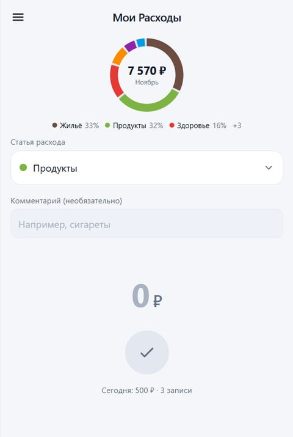
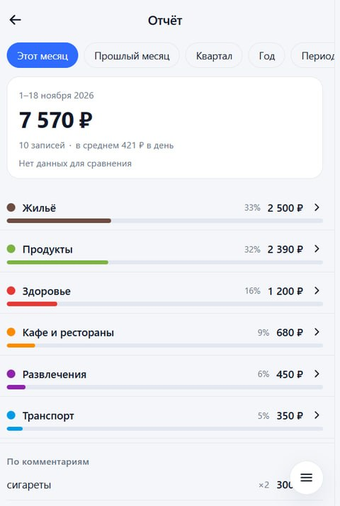
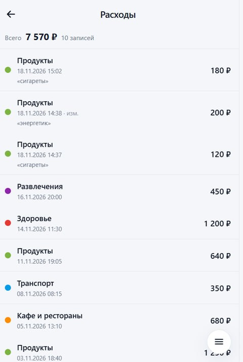

# Мои Расходы

**Быстрый учёт личных трат: статья, сумма, одно нажатие.** Android-приложение, которое работает офлайн, без регистрации и без сервера — все данные остаются на устройстве.


## ⬇️ Скачать

**[Мои Расходы 1.1 (APK, 3 МБ)](https://github.com/Exclusive8786/moi-rashody/releases/latest/download/Moi-Rashody-1.1.apk)**

Ссылка всегда ведёт на самую свежую версию. Android 6.0 и новее.

## О приложении

Большинство трекеров расходов требуют регистрации, подписки или ручного разбора банковских выписок. «Мои Расходы» решают одну задачу — **записать трату за пару секунд**, пока вы стоите у кассы, — и сразу показывают, куда уходят деньги.

- На главном экране: кольцо месяца с разбивкой по категориям, выбор статьи, крупное поле суммы и круглая кнопка подтверждения.
- Необязательный комментарий помогает различать траты внутри категории: «Вредные привычки» → `сигареты`, `энергетик`. Ранее введённые комментарии подсказываются при вводе.
- Отчёт по комментариям отвечает на вопрос «сколько раз и на сколько я покупал сигареты» — количество записей и сумма за период.
- Всё хранится только на телефоне: нет аккаунта, аналитики и сетевых запросов. Есть экспорт и импорт JSON.

## Скриншоты

<p align="center">
  
  
  
</p>

<details>
<summary>Все расходы и тёмная тема</summary>

<p align="center">
  
  
</p>

</details>

## Возможности

**Главный экран.** Кольцо месяца: сумма внутри, сегменты по категориям и легенда с долями (тап → отчёт). Выбор статьи, крупное поле суммы, круглая кнопка, сумма за сегодня.

**Комментарии.** Необязательный комментарий до 40 символов, подсказки из ранее введённых, очистка одним тапом.

**Все расходы.** Журнал от новых к старым: статья, сумма, дата, время, комментарий. Свайп влево — удалить, тап — изменить, отмена удаления в течение 5 секунд.

**Отчёт.** Этот месяц, прошлый, квартал, год или свой период. Итог, число записей, среднее в день, динамика. Разбивка по статьям с долями и раскрытием до записей по дням. Блок «По комментариям» с количеством и суммой.

**Настройки.** Категории: добавление, переименование, цвет (12 цветов + свой), порядок перетаскиванием, удаление с сохранением записей как «Без категории». Валюта, светлая/тёмная тема, экспорт/импорт JSON, очистка данных.

Дополнительно: валидация суммы (запятая и точка, копейки, лимит), защита от двойного сохранения, запрет будущих дат, `safe-area` для вырезов экрана, доступные тач-зоны и подписи.

## Технологии

- **UI:** React 18, TypeScript, CSS-переменные без UI-библиотек
- **Сборка:** Vite 5, PWA через `vite-plugin-pwa`
- **Данные:** IndexedDB (`idb`), настройки в `localStorage`
- **Даты и деньги:** `date-fns`, суммы хранятся в копейках (целые числа)
- **Android:** Capacitor 7, подписанный release-APK
- **Иконки:** Material Symbols (Apache 2.0), рендер через `sharp`

## Установка

1. Скачайте APK на телефон и откройте его из «Загрузок» (или из чата, куда скачали).
2. Если появится «Заблокировано неизвестным источником» — разрешите установку для приложения, из которого открываете файл (Файлы, Chrome, Telegram).
3. Если Google Play Защита предложит **«Проверить приложение»** — это нормально: приложение не из магазина, Google его ещё не видел. Нажмите «Проверить» (файл уйдёт на проверку, обычно через минуту появляется «Установить») либо установите через файловый менеджер.

Обновления ставятся поверх: у всех версий один и тот же ключ подписи, данные сохраняются.

## Структура репозитория

```
app/                     исходники приложения
  src/
    screens/             Home, Expenses, Report, Settings
    components/          кольцо месяца, шторки, диалоги, тосты, редактор записи, комментарий
    db.ts                схема IndexedDB и операции
    store.tsx            состояние приложения и действия
    lib/                 деньги, даты, периоды, склонения
  android/               нативный проект Capacitor
  public/                иконки и favicon
  scripts/               генерация иконок и splash-экранов
docs/screenshots/        скриншоты для README
```

## Запуск (веб-версия)

```bash
cd app
pnpm install
pnpm dev        # http://127.0.0.1:5178
```

Проверка и сборка:

```bash
pnpm test       # юнит-тесты сумм и периодов (vitest)
pnpm build      # tsc + vite build → dist/
pnpm preview    # предпросмотр собранной версии
```

## Сборка APK

```bash
cd app
pnpm build
npx cap sync android
cd android
./gradlew assembleRelease   # Windows: gradlew.bat assembleRelease
# → app/build/outputs/apk/release/app-release.apk
```

Для подписанной сборки рядом с `app/android/build.gradle` нужен файл `keystore.properties`:

```properties
storeFile=keystore/your-key.jks
keyAlias=your-alias
storePassword=********
keyPassword=********
```

и сам ключ в `app/android/keystore/`. Оба пути перечислены в `.gitignore` — в репозиторий ключ не попадает и не должен. Без этого файла соберётся неподписанный APK.

**Ключ подписи нужно хранить отдельно и не терять:** обновление установится поверх старой версии только с тем же ключом. Если ключ потерян, пользователям придётся удалить приложение вместе с данными.

## Данные и приватность

- Нет сервера, аккаунтов, аналитики и трекеров — приложение не делает сетевых запросов.
- Веб-версия и APK хранят данные независимо (разные origins). Перенос — через экспорт JSON в настройках.
- Очистка кэша браузера удаляет записи: перед этим сделайте экспорт. В APK данные живут до удаления приложения.
- Экспорт отдаёт `expenses-backup-ГГГГ-ММ-ДД.json`; импорт проверяет схему и заменяет данные.

## Дорожная карта

- [ ] Поиск и фильтры в журнале (по статье, сумме, дате)
- [ ] Бюджеты по категориям и индикатор «осталось»
- [ ] Регулярные расходы и подписки
- [ ] Графики расходов по дням и неделям
- [ ] Синхронизация между устройствами (опционально, с шифрованием)

## Проверка файла

Размер: 3 145 652 байт
SHA-256: `ebf4aec59b0cc25edfd3ce39bf0ddb7156aa322993adc5d94021da74e4085d46`

```
certutil -hashfile Moi-Rashody-1.1.apk SHA256
```

## Лицензия

[MIT](LICENSE) © 2026 Сергей Горелов

## Атрибуция

Иконка приложения основана на символе `account_balance_wallet` из [Material Symbols](https://fonts.google.com/icons) (Google, Apache License 2.0).
